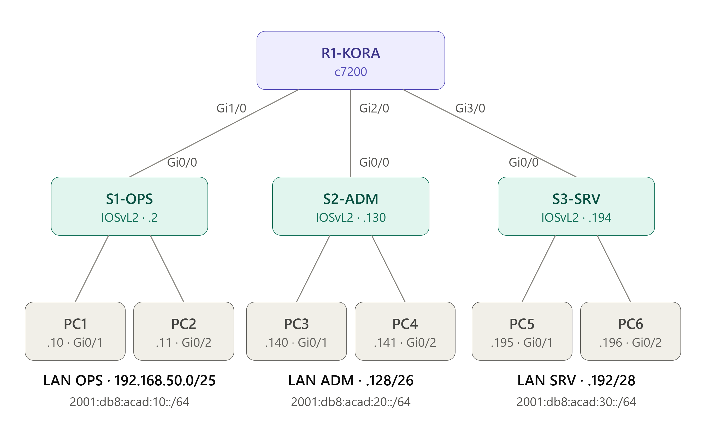
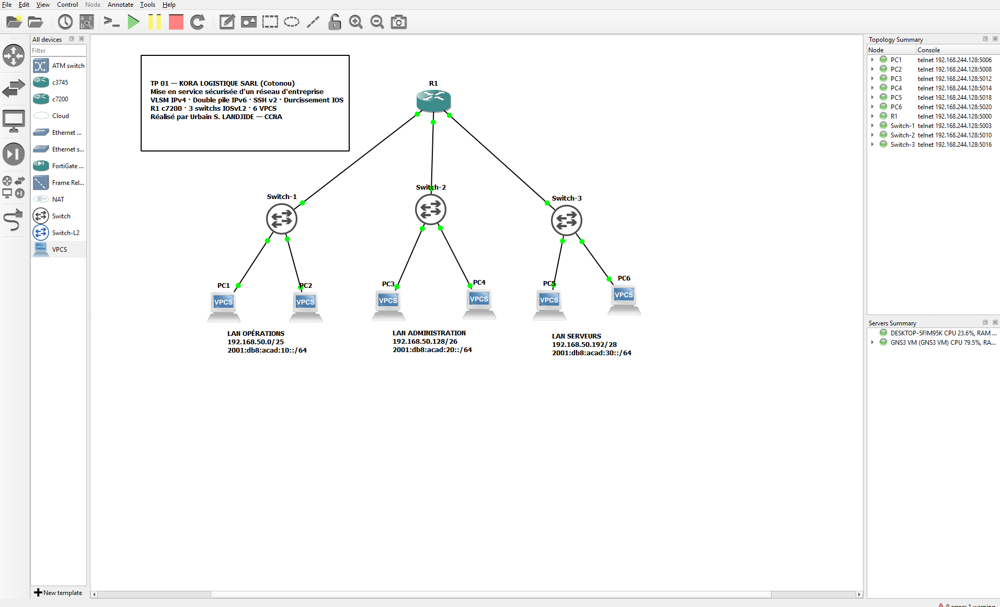
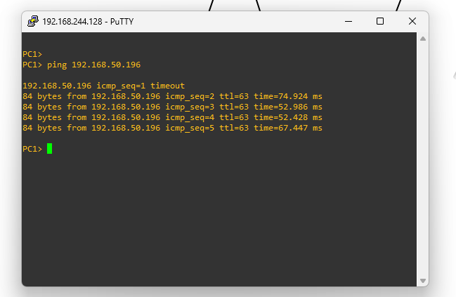
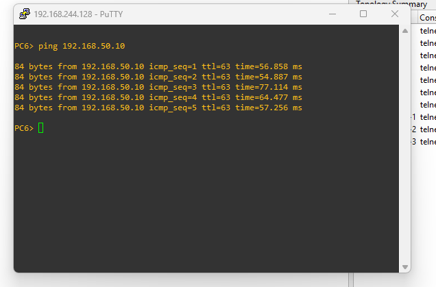

# 🚚 TP 01 — Kora Logistique : mise en service sécurisée d'un réseau d'entreprise


> Premier TP de ma série **« TP de terrain »** : des scénarios d'entreprise réalistes, avec un cahier des charges client, des calculs à faire, une recette à valider et des **pannes à dépanner**.

---

## 📋 Contexte

> ℹ️ **Scénario fictif** : Kora Logistique est une entreprise inventée pour ce TP, afin de travailler sur un cas réaliste.

**Kora Logistique SARL**, une entreprise de transport installée dans la zone portuaire de **Cotonou** 🇧🇯, emménage dans un nouveau bâtiment sans aucun réseau. Son ancien prestataire avait laissé **Telnet ouvert et les mots de passe en clair**.

Mission : concevoir l'adressage, mettre en service et **sécuriser** l'infrastructure, puis livrer un réseau documenté, prêt pour **IPv6**.

---

## 🎯 Compétences mobilisées

| Domaine | Notions | Modules |
|---|---|---|
| Adressage | **VLSM** IPv4, plan d'adressage, IPv6 GUA + link-local | ITN 11-12 |
| Configuration IOS | Modes CLI, hostname, bannière, descriptions, sauvegarde | ITN 2, SRWE 1 |
| Sécurité | `enable secret`, chiffrement, longueur min., anti-force-brute, timeouts | ITN 16 |
| Administration | **SSH v2**, comptes locaux, SVI de gestion, passerelle par défaut des switchs | SRWE 1 |
| Durcissement | Désactivation des ports inutilisés | SRWE 1 |
| Protocoles | ARP, NDP, ICMP / ICMPv6, DNS, HTTP | ITN 9, 13, 15 |
| Dépannage | Méthode par couches OSI, **8 tickets réalistes** | ITN 17 |

---

## 🗺️ Topologie

```
                         ┌────────────────────────┐
                         │        R1-KORA         │
                         │       ISR 4331         │
                         └──┬─────────┬─────────┬─┘
                     G0/0/0 │   G0/0/1│   G0/0/2│
                            │         │         │
                       G0/1 │    G0/1 │    G0/1 │
                     ┌──────┴─┐ ┌─────┴──┐ ┌────┴───┐
                     │ S1-OPS │ │ S2-ADM │ │ S3-SRV │
                     └─┬────┬─┘ └─┬────┬─┘ └─┬────┬─┘
                   F0/1│    │F0/2 │    │     │    │
                  PC-OPS1 PC-OPS2 PC-ADM1 PC-ADM2 SRV-DNS SRV-WEB

     OPÉRATIONS (100 hôtes)  ADMINISTRATION (50)   SERVEURS (10)
```

### Schéma (réalisation GNS3)



### Vue GNS3



---

## 📊 Adressage (résumé)

| Service | IPv4 | IPv6 | Passerelle |
|---|---|---|---|
| OPÉRATIONS | 192.168.50.0/25 | 2001:db8:acad:10::/64 | .1 / fe80::1 |
| ADMINISTRATION | 192.168.50.128/26 | 2001:db8:acad:20::/64 | .129 / fe80::1 |
| SERVEURS | 192.168.50.192/28 | 2001:db8:acad:30::/64 | .193 / fe80::1 |
| *Réserve* | *192.168.50.208 → .255* | — | — |

➡️ Détail complet et calculs : [`2-adressage.md`](2-adressage.md)

---

## 📂 Organisation du TP

| Fichier | Contenu |
|---|---|
| [`1-cahier-des-charges.md`](1-cahier-des-charges.md) | Les besoins du client, **sans solution** |
| [`2-adressage.md`](2-adressage.md) | Calcul VLSM et table d'adressage à compléter, puis corrigé |
| [`3-taches.md`](3-taches.md) | 7 phases guidées avec **checkpoints** et indices |
| [`4-verification.md`](4-verification.md) | Commandes `show` et **résultats attendus** (recette) |
| [`5-depannage.md`](5-depannage.md) | **8 tickets** de support à résoudre |
| [`6-questions.md`](6-questions.md) | 12 questions type examen CCNA |
| [`configs/solution/`](configs/solution/) | Configurations finales complètes |
| [`configs/pannes/`](configs/pannes/) | Script d'injection des pannes (pour le binôme) |
| [`configs/solution-gns3/`](configs/solution-gns3/) | Configurations pour GNS3 (c7200, IOSvL2, VPCS) |
| [`topologie/`](topologie/) · [`captures/`](captures/) | Schéma et captures de la réalisation |

---

## ✅ Recette client

- [ ] Communication IPv4 **et** IPv6 entre tous les services
- [ ] `http://www.koralog.bj` accessible depuis les postes
- [ ] SSH v2 vers le routeur et les 3 switchs depuis l'administration
- [ ] Telnet refusé
- [ ] Aucun mot de passe en clair
- [ ] Configurations sauvegardées

---

## 📸 Résultats

**PC1 → SRV-WEB (192.168.50.196)** : le 1er paquet est perdu le temps de la résolution ARP, puis 4/4. Le **TTL 63** montre qu'un routeur a été traversé.



**PC6 → PC1 (192.168.50.10)** : 5/5, d'un LAN à l'autre.



---

## 💡 Commandes clés

| Commande | Rôle |
|---|---|
| `security passwords min-length 10` | Impose une longueur minimale aux nouveaux mots de passe |
| `login block-for 120 attempts 3 within 60` | Bloque les connexions après 3 échecs en 60 s |
| `crypto key generate rsa general-keys modulus 2048` | Génère les clés nécessaires à SSH |
| `transport input ssh` | Autorise **uniquement** SSH sur les lignes VTY |
| `ip default-gateway` | Permet à un switch L2 de répondre hors de son réseau |
| `ipv6 address fe80::1 link-local` | Fixe une link-local lisible, passerelle commune aux hôtes |
| `ipv6 unicast-routing` | Active le routage IPv6 et l'envoi des RA |

---

## 🧭 Série « TP de terrain »

| # | TP | Type | Statut |
|---|---|---|---|
| **01** | **Kora Logistique — Base, SSH, VLSM, double pile** | Construction | ✅ |
| D1 | Clinique Saint-Luc — 15 pannes couches 1 à 3 | Dépannage | ⏳ |
| 02 | AfriBank — VLAN, trunk, Router-on-a-Stick, DHCPv4 | Construction | ⏳ |
| D2 | Port Autonome — 18 pannes VLAN / trunk / DHCP | Dépannage | ⏳ |
| 03 | CHU Cotonou — switch L3, Rapid PVST+, EtherChannel, relais DHCP | Construction | ⏳ |
| D3 | Usine Sodji — 20 pannes STP / EtherChannel | Dépannage | ⏳ |
| 04 | Université d'Abomey — SLAAC, DHCPv6 | Construction | ⏳ |
| D4 | Opérateur IPv6 — 15 pannes IPv6 | Dépannage | ⏳ |
| 05-06 | HSRP, sécurité LAN, projet final multisite (GNS3) | Construction + dépannage | ⏳ |

---

## 👨‍💻 Auteur

**Urbain Sedami Landjidé**
🎓 Étudiant en 2ème année — Licence Professionnelle
📡 Réseaux Informatique Mobilité Sécurité (RMS)
🏫 Cisco Networking Academy (en partenariat avec Pigier Bénin)
📍 Cotonou, Bénin 🇧🇯

🌐 Portfolio : [portfolio-urbain.vercel.app](https://portfolio-urbain.vercel.app/projets/ccna-tp01-koralogistique)

[](https://www.linkedin.com/in/urbain-sedami-landjide-9b49043a8/)

---

## 📄 Licence

[](https://opensource.org/licenses/MIT)
